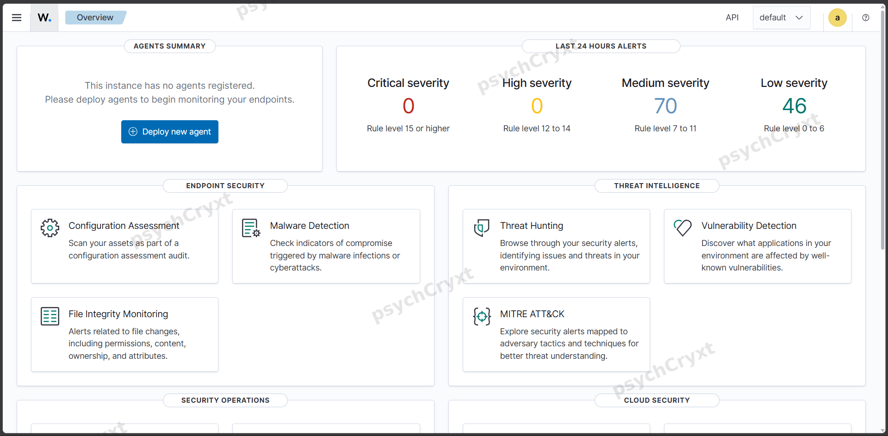

# My Homelab: A Three-Machine Security Lab

_Built up since June 2026. Wazuh SIEM added Nov 11, 2026._

This is the setup everything in this journal runs on. What started as
"can I host my own storage" (Nextcloud on a home server, reached
safely through Tailscale) has grown into a small security lab: one
machine that defends, one that attacks, and one that watches.

## The machines

**Mac mini (Ubuntu Server, 8 GB RAM): the base server**
Always on. It runs my Docker stack, including Nextcloud, served over
HTTPS on my tailnet through Tailscale Serve. Since Nov 11, 2026 it
also runs the full Wazuh stack: manager, indexer and dashboard. In
Wazuh terms it is the manager, and once I deploy its agent it becomes
a monitored endpoint too.

**HP EliteBook (Windows): my personal machine, the viewing seat**
My daily driver. It reaches the Wazuh dashboard in a browser and
SSHes into the server. Later I may add the Windows agent so this
machine is monitored as well.

**Dell Latitude: the attacker machine (in progress)**
Reserved for Kali Linux. The first install died at the GRUB boot
loader step, the drive had to be wiped clean, and a fresh install is
still to do. The trackpad has gone stiff, so this box will be driven
keyboard-only. No Wazuh agent will ever go on it: its job is to make
the noise the SIEM has to catch.

**Raspberry Pi: the original homelab node**
Part of the June 2026 build, alongside the server and Pi-hole.
A candidate for a Wazuh agent once the basics are working.

**iPhone: a client**
Nextcloud app, talking to the server on its HTTPS tailnet address.

## How it connects

- Home LAN carries the lab traffic: attacks, agents, dashboard.
- Tailscale sits over the top: MagicDNS names, HTTPS certificates,
  SSH access, and Nextcloud served on its tailnet name.
- Nothing is port-forwarded to the public internet.

## Services

| Service | Where | Notes |
|---|---|---|
| Nextcloud | Mac mini (Docker) | HTTPS via Tailscale Serve on port 443. Lightly used; I keep it because I like knowing I can host my own storage. It can be paused if the SIEM needs the RAM |
| Wazuh 4.14.10 | Mac mini | Manager, indexer, dashboard on port 8443 (443 was already taken by Nextcloud's Serve endpoint, which cost me one failed install attempt). Installed Nov 11, 2026 |
| Pi-hole | Homelab | DNS filtering, from the original build |
| Tailscale | All nodes | The fabric: names, certificates, remote access |

## Where it stands

The Wazuh stack is up and the dashboard is live. It already shows the
manager's own alerts, but no agents are registered yet. Next steps, in
order: deploy the agent on the mini itself, finish the Kali install on
the Dell, then attack the mini from the Dell and go find the attack in
the dashboard from the EliteBook. Red team on one side of the room,
blue team on the other, and I am both.

