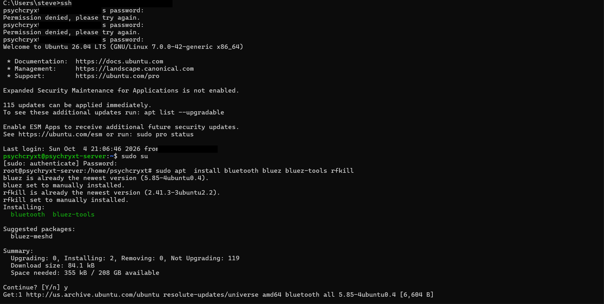
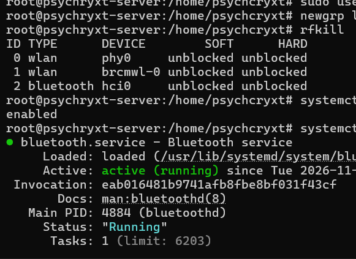
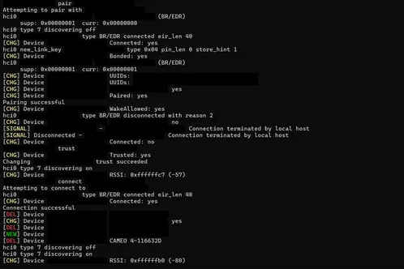
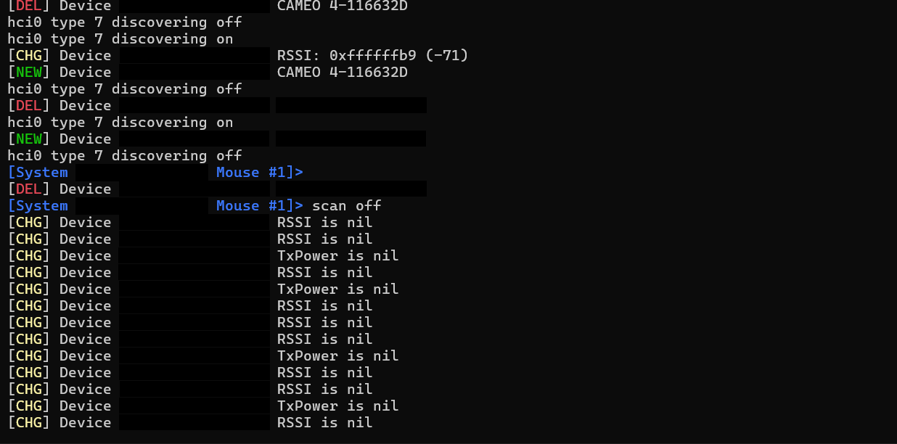
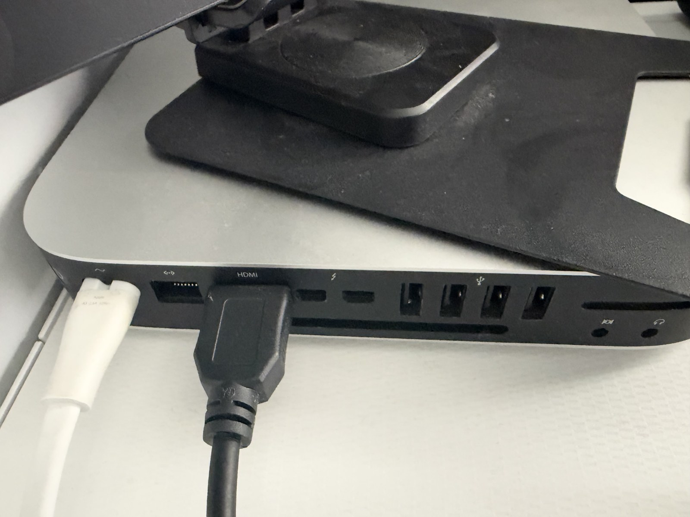

# No Keyboard, No Mouse, Bluetooth Off: Pairing a Magic Mouse to My Ubuntu Mac Mini over SSH

*November 10, 2026*

## The situation

I wanted to use my Mac mini, which runs Ubuntu, to check some things. One problem: I had sold my wired keyboard and mouse, so the only ones left in the house were my wireless set, and Bluetooth was switched **off** on the mini. The display was connected and working. I just had no way to click or type anything into the machine sitting right in front of me.

## The way in

Luckily, past me did present me a favour. The mini is set up to connect to my Tailscale VPN automatically on boot. So I joined Tailscale on my personal computer, and SSH'd straight into the mini over the VPN.

First I had a smaller problem: it had been a while since I last logged in, and I had forgotten the password. You can see my two failed attempts in the screenshot below: `Permission denied, please try again.` I keep the password written down, but scrambled in my own way, so even with physical access to the note it would be meaningless to anybody else. Third try, I was in, and I elevated to root with `sudo su`.



## Setting up Bluetooth from the terminal

I searched online for how to handle Bluetooth connections purely from the command line, and found `bluetoothctl`. I installed the Bluetooth stack:

```bash
sudo apt install bluetooth bluez bluez-tools rfkill
```

(BlueZ was already the newest version.) There was a small detour here: I added my user to the `lp` group (`usermod -aG lp`), and `newgrp` turned out not to be installed, so I installed `util-linux-extra` to get it. Real sessions are never as clean as tutorials.

Then I checked that nothing was blocking the radio:

```bash
rfkill            # bluetooth hci0: unblocked / unblocked (soft and hard)
systemctl status bluetooth   # enabled, active (running)
```



## Finding the mouse in the noise

Inside `bluetoothctl`, I started a scan:

```
scan on
```

The screen flooded. Dozens of devices: phones, lights, things belonging to my neighbours that I will never know. Every Bluetooth device announces itself with a MAC address, and the scan lists them live with their RSSI (signal strength: the closer the device, the stronger the number). My job was to work out which of those addresses belonged to the Magic Mouse in my hand.


## The pairing saga

This is the part the tutorials skip. An Apple Magic Mouse is *not* as easy as a normal mouse.

1. I paired with the mouse's address: `pair <MAC>`, and got **"Pairing successful."**
2. Then it disconnected on its own almost immediately.
3. I tried to pair again and got `org.bluez.Error.AlreadyExists`, because the mini thought it already knew this mouse.
4. So I removed the device completely (`remove <MAC>`), scanned again, and paired fresh.
5. This time I added the two steps that made it stick: `trust <MAC>` (so the mini accepts it automatically from now on) and then `connect <MAC>`, and got **"Connection successful."**

The moment I knew it had really worked: the `bluetoothctl` prompt itself changed to the mouse's name: `[System Administrator's Mouse #1]>`. And on the display, the cursor moved. The mouse was alive on the mini.





With a working mouse, the rest was easy: I opened the Bluetooth settings on the mini and connected the wireless keyboard through the normal graphical way, like a normal person.




## If you're in this same trouble: the short guide

1. **Get in without input devices.** If the machine runs SSH and connects to a VPN like Tailscale automatically on boot, join the VPN from another computer and SSH in. Set this up *before* you need it.
2. **Install the stack:** `sudo apt install bluetooth bluez bluez-tools rfkill`
3. **Check the radio isn't blocked:** `rfkill` should show Bluetooth as unblocked (soft and hard). Check the service: `systemctl status bluetooth`. It should be enabled and active.
4. **Scan:** run `bluetoothctl`, then `scan on`. Toggle your device off and on and watch which address appears/disappears; check the RSSI to confirm it's the close one.
5. **Pair:** `pair <MAC>`. If it pairs and then drops, or complains the device already exists: `remove <MAC>`, scan again, pair again.
6. **Make it stick:** `trust <MAC>`, then `connect <MAC>`.
7. **Apple devices:** expect the remove-and-re-pair step. It's not you, it's the mouse.

## What I learned

- Bluetooth devices are identified by MAC addresses, and **pairing, trusting, and connecting are three separate steps**. Skipping "trust" is why connections don't survive.
- RSSI is a distance clue hiding in plain sight in the scan output.
- A scan in a shared building is a reminder of how much radio noise surrounds us. I could see my neighbours' devices from my desk.
- The real hero was a boring setup decision made long before: **out-of-band access** (Tailscale auto-connect on boot + SSH). "No way to type into this machine" stopped being an emergency because another door was already open.

## Credit

The guide that helped me through the command-line Bluetooth steps: [Connect to Bluetooth Device from Linux Terminal](https://computingforgeeks.com/connect-to-bluetooth-device-from-linux-terminal/) by ComputingForGeeks.
